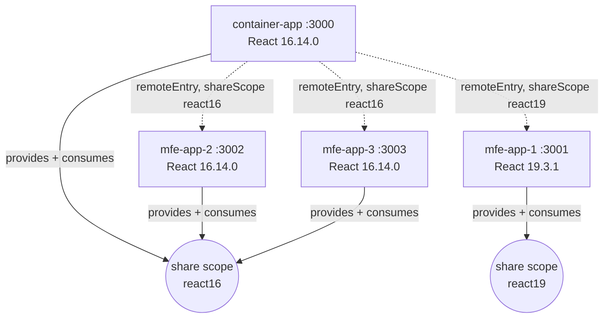

# Migration Option B — Separate Module Federation Share Scopes

**Branch:** `migration/react19-share-scopes`
**Baseline commit:** `163dd263517373c80fbabc92eec3e11ba86b0aa1` (`main`, Part 1)
**Scope:** upgrade MFE App 1 to React 19 while the container, App 2 and App 3 stay on React 16.14.0.

This document describes what was implemented, how it was verified, what it costs and how to
undo it. All measurements come from this branch; nothing here is quoted from theory.

---

## 1. Architecture

React 16 and React 19 run side by side on one page. They never share a React instance, because
each generation resolves its runtime from a **different Module Federation share scope**:



Every application still owns its own React root and is mounted through the unchanged
`mount(element, props) -> { unmount, getRuntimeInfo }` contract (PRD 2.2). No React element,
hook or context crosses an application boundary, and no React Bridge package is used.

Because `react16` is a scope of its own, the three React 16 applications keep sharing **one**
instance exactly as in the baseline; `react19` is a second, independent singleton domain.

## 2. Webpack configuration

The shared configuration lives in [`shared/webpack.base.js`](../shared/webpack.base.js). Two
declarations are needed per application — the generation descriptor and the `shared` map built
from it:

```js
const REACT16 = { label: "react16", shareScope: "react16", version: "16.14.0", requiredVersion: "^16.14.0" };
const REACT19 = { label: "react19", shareScope: "react19", version: "19.3.1", requiredVersion: "^19.3.1" };

function createReactShared({ shareScope, version, requiredVersion }) {
  const options = { singleton: true, requiredVersion, strictVersion: true, shareScope, version };
  return {
    react: { ...options },
    "react-dom": { ...options },
    "react/": { ...options },      // subpath sharing: react/jsx-runtime
    "react-dom/": { ...options },  // subpath sharing: react-dom/client
  };
}
```

`singleton: true` is retained **inside each scope**, `strictVersion: true` makes an incompatible
lookup fail loudly instead of rendering with the wrong runtime, and local fallbacks stay enabled
(no `import: false`, no disabled fallback), so every build can also run standalone.

Per-application wiring:

| Application | webpack config passes | Scope |
|---|---|---|
| container-app | `react: REACT16`, object-form `remotes` with a `shareScope` per remote | react16 |
| mfe-app-1 | `react: REACT19` | react19 |
| mfe-app-2 / mfe-app-3 | `react: REACT16` | react16 |

Host remote definitions ([`container-app/webpack.config.js`](../container-app/webpack.config.js)):

```js
remotes: {
  mfeApp1: { external: `mfeApp1@${url3001}`, shareScope: "react19" },
  mfeApp2: { external: `mfeApp2@${url3002}`, shareScope: "react16" },
  mfeApp3: { external: `mfeApp3@${url3003}`, shareScope: "react16" },
}
```

URLs still come from `.env`; only the scope name is added.

### 2.1 The one non-obvious requirement

Declaring `shared["react"].shareScope` is **not sufficient**. A remote also has to declare the
top-level `shareScope` option of `ModuleFederationPlugin`, i.e. the scope name its *container
entry* binds the host's scope map to:

```js
new ModuleFederationPlugin({
  name,
  shareScope: react.shareScope, // <- required on every REMOTE build
  filename: "remoteEntry.js",
  exposes: { "./App": "./src/mount.js" },
  shared: createReactShared(react),
});
```

Webpack's container entry does `shareScopeMap[name] = hostProvidedMap`, where `name` is that
top-level option (default `"default"`), and the remote's consumers then look up
`shareScopeMap[shared["react"].shareScope]`. With only the per-dependency setting, the host's
`react16` map landed under the key `default`, the remote's consumers looked for `react16`, found
nothing and silently fell back to their own bundled React.

Measured evidence, before the fix: each remote downloaded its own `325.js` (react-dom 16, 119.2
KiB) and App 2/App 3 reported `shares container instance = no`. After the fix: one React 16 copy
on the page, `shares = yes` for both remotes. See
[`docs/performance-option-b-runtime.md`](./performance-option-b-runtime.md).

### 2.2 Scope initialisation and loading order

Initialising a scope also pulls every remote registered **in that scope**: the container's first
`react16` consumption triggers `remoteEntry.js` loads for App 2 and App 3 even when the user has
only opened App 1. That is webpack's generated `remotes` chunk handler, not application code. The
runtime network log shows those requests in the `initial` phase, and it is the main loading-shape
difference from the Part 1 baseline (see section 6).

## 3. React 19 application changes

Only `mfe-app-1` changed.

| Package | Baseline (main) | Option B (this branch) | Why |
|---|---|---|---|
| `react` | 16.14.0 | **19.3.1** | PRD target was 19.3.0; 19.3.1 is the current stable (verified with `npm view react dist-tags` → `latest: 19.3.1`). Documented as a version update, same 19.x line. |
| `react-dom` | 16.14.0 | **19.3.1** | must match `react` exactly |
| `redux` | 4.0.5 | **5.0.1** | `react-redux` 9 requires `redux ^5` |
| `react-redux` | 7.2.2 | **9.3.1** | 7.x peer range is `^16.8.0 \|\| ^17`; 9.x supports `^18 \|\| ^19` |
| `react-router-dom` | 5.2.0 | **5.3.4** | 5.3.x dropped `mini-create-react-context` (a React-16-era `createContext` polyfill that pokes at removed legacy context internals). Public v5 API is unchanged, so no route code changed. |
| `jest`, `babel-jest`, `jest-environment-jsdom` | 26.6.3 (root) | **30.5.2** (App 1 devDeps only) | Jest 26's jsdom/RTL generation cannot host React 19 |
| `@testing-library/react` | 11.2.5 (root) | **16.3.3** (App 1 devDeps) | RTL 16 is the React 18/19 compatible line |
| `@testing-library/dom` | — (transitive) | **10.4.2** | peer of RTL 16 |
| `@testing-library/user-event` | 12.6.0 (root) | **14.6.8** (App 1 devDeps) | user-event 14 API is async (`await user.click(...)`) |
| `@testing-library/jest-dom` | 5.11.9 (root) | **6.9.1** (App 1 devDeps) | v5's `extend-expect` entry point is gone in the v6 line |

Container, App 2 and App 3 dependency versions are untouched (PRD 3.2). npm workspaces keep React
19 nested under `mfe-app-1/node_modules`, so the hoisted React 16.14.0 at the repository root
still serves the other three applications.

**On the React 18.3 intermediate checkpoint (PRD 5.4):** it was evaluated and skipped as a
*published* step, and App 1 ends on React 19.3.1 as required. Every API this application needs is
shared by 18 and 19 — `createRoot`/`root.unmount()`, the automatic JSX runtime, `act` from `react`,
`react-redux@9` (`react ^18 || ^19`) and RTL 16 — so an 18.3 checkpoint would have exercised the
same code paths twice without adding verification value in a single-remote scope. The checkpoint is
worth taking in a larger estate where React 18-only deprecation warnings (`findDOMNode`, legacy
context, `propTypes`/`defaultProps`) must be flushed out of many remotes before 19; if that is
needed later, `npm i -w mfe-app-1 react@18.3 react-dom@18.3` is the only change, and the mount
contract already supports both generations.

### 3.1 Code changes required by React 19

* **Rendering API.** React 19 removed `ReactDOM.render` / `unmountComponentAtNode`.
  [`shared/mount-contract.js`](../shared/mount-contract.js) now supports both back-ends and picks
  one from the binding it is given: `createRoot(element).render(...)` + `root.unmount()` when the
  caller passes `react-dom/client`, otherwise the React 16 path. App 1 passes `createRoot`; the
  React 16 apps pass `ReactDOM` unchanged. **The public `mount`/`unmount` contract, and all
  container code, are unchanged.**
* **Diagnostics.** `getRuntimeInfo()` gained `renderer` and `shareScope` (plus the scope probe tag)
  so the browser can report which API and scope each application really resolved.
* **JSX transform.** App 1 builds with the automatic runtime
  (`mfe-app-1/babel.config.js`, `runtime: "automatic"`), which is why `react/jsx-runtime` has to be
  shared through the `react/` subpath entry. The React 16 apps keep the classic runtime in the root
  Babel config, so their components still need `import React` — untouched.
* **Removed API audit.** `ReactDOM.hydrate`, function-component `propTypes`/`defaultProps`, string
  refs, legacy lifecycles and `forwardRef` usage: none present, nothing to migrate.
* **Tests.** App 1's unit tests use `act` imported from `react`, awaited `userEvent` calls and
  `globalThis.IS_REACT_ACT_ENVIRONMENT = true`. Existing assertions were kept or strengthened (the
  runtime info assertions now also cover `renderer`, `shareScope` and the probe tag); none were
  removed.

## 4. Runtime version diagnostics

`/diagnostics` in the container probes every remote through the real Module Federation runtime
(mount into a hidden node → `getRuntimeInfo()` → unmount) and prints, for each application:

| Column | Source |
|---|---|
| React / React DOM | `React.version`, `react-dom` version of the module the app actually executes with |
| Rendering API | `react-dom:render` vs `react-dom/client:createRoot` |
| Share scope | scope declared by that application |
| Container React instance | identity probe (below) |

The identity probe ([`shared/scope-probe.js`](../shared/scope-probe.js)) writes a random token on
the React **module object** the container resolved, before any remote loads. Each remote reads the
tag back from the React object *it* resolved and reports it. Same token ⇒ the scope handed out the
container's instance; no tag ⇒ a runtime of its own. Only plain strings cross the application
boundary, so the "never pass React objects between applications" rule still holds. This is what
makes "one React 16 instance, one React 19 instance" a measured statement instead of an inference
from `shared` configuration.

## 5. Running and testing this branch

```bash
npm ci                      # installs React 19 nested for mfe-app-1
npm run build               # four independent production builds
npm run start               # dev servers: 3000 container, 3001 app1 (React 19), 3002, 3003
npm run preview             # static preview of the production builds (used by browser suites)
```

| Command | What it runs |
|---|---|
| `npm run test:unit` | both unit projects: React 16 stack (Jest 26) **and** App 1 (Jest 30 + RTL 16) |
| `npm run test:unit:react16` | container + App 2 + App 3 unit tests |
| `npm run test:unit:app1` | App 1 unit tests only (React 19 project) |
| `npm run test:integration` | builds, then Playwright integration specs against real federation |
| `npm run test:e2e` | Playwright E2E + regression suite |
| `npm run test:all` | unit + integration + E2E |
| `npm run test:coverage` | coverage for both unit projects |
| `npm run build:stats` | regenerates `docs/performance-option-b.md` |
| `npm run perf:option-b` | regenerates `docs/performance-option-b-runtime.md` (starts the four preview servers itself) |
| `npm run lint` | ESLint (App 1 files linted with the automatic-JSX override) |

The App 1 unit project needs its own Jest config because `rootDir` is `mfe-app-1` (so Jest resolves
the Jest 30 environment and `babel-jest` from that workspace) and because every React-related
specifier is remapped to `mfe-app-1/node_modules`: see
[`tests/unit/mfe-app-1/jest.config.js`](../tests/unit/mfe-app-1/jest.config.js). The expected
runtime matrix is declared once in [`tests/expectations.js`](../tests/expectations.js).

### 5.1 Results on this branch

| Suite | Result |
|---|---|
| Unit — React 16 projects (container, App 2, App 3) | 26 passed |
| Unit — App 1 (React 19) | 14 passed |
| Integration (federation loading, mount/unmount, isolation, version resolution, share-scope initialisation) | 15 passed |
| E2E incl. `mfe-regression` and `react-runtime` | 19 passed |
| Console errors / failed requests during browser suites | none |

Browser suite composition: `federation-loading` 2, `mount-unmount` 2, `application-isolation` 2,
`react-version-resolution` 4, `share-scope-initialization` 5 (new), `navigation` 2, `app1/2/3` 8,
`mfe-regression` 4, `react-runtime` 4 (rewritten for mixed versions).

The Part 1 regression matrix (PRD 7.3) passes unchanged: container loads, each app loads, Redux
interactions, navigation, mount/unmount, no critical console errors — with "correct React version"
now reading *mixed 16/19* instead of *all 16*.

## 6. Performance

Build sizes (production, KiB) — Option B versus the frozen Part 1 baseline:

| Application | Baseline raw / gzip | Option B raw / gzip | Δ raw |
|---|---|---|---|
| containerApp | 185.9 / 59.1 | 188.0 / 59.8 | +2.1 |
| mfeApp1 | 203.7 / 66.5 | 303.5 / 98.9 | +99.8 |
| mfeApp2 | 181.4 / 59.0 | 181.8 / 59.2 | +0.4 |
| mfeApp3 | 181.3 / 59.0 | 181.7 / 59.3 | +0.4 |

React contribution per build (`react` + `react-dom` modules in the module graph):

| Application | Scope | Baseline | Option B |
|---|---|---|---|
| containerApp | react16 | 6.8 + 117.4 | 6.8 + 117.4 |
| mfeApp1 | react19 | 6.8 + 117.4 | 25.9 + 620.5 |
| mfeApp2 | react16 | 6.8 + 117.4 | 6.8 + 117.4 |
| mfeApp3 | react16 | 6.8 + 117.4 | 6.8 + 117.4 |

What the running page actually downloads (uncompressed, `npm run perf:option-b`):

| Metric | Measured |
|---|---|
| JS requests for the full session (initial + App 2 + App 3 + diagnostics) | 21 |
| Total JS transferred | 570.4 KiB |
| Transferred during initial load | 486.5 KiB |
| React 16 assets downloaded | 2 assets, 126.3 KiB — **one copy for three applications** |
| React 19 assets downloaded | 4 assets, 214.8 KiB — App 1 only |
| DOMContentLoaded / shell visible / first remote mounted | 26 / 74 / 109 ms |
| App 2 mount after navigation / App 3 mount after navigation | 45 / 50 ms |
| Runtime errors during measurement | 0 |

Interpretation:

* The cost of the migration is concentrated in App 1: React 19's `react-dom` is roughly five times
  the module weight of React 16's, and App 1 now carries its own runtime because no other
  application consumes `react19`. This is the expected migration-period cost, not a configuration
  defect.
* Duplication *within* a generation is avoided: the browser downloaded one React 16 payload
  (`325.js` + `696.js`, 126.3 KiB) and App 2/App 3 both report the container's instance tag. Note
  that the copy served to the page came from the App 3 build (`localhost:3003/…`), not from the
  container: with equal versions in one scope, which provider wins depends on registration order
  during scope initialisation. The container still holds its own fallback, so it does not depend on
  a remote for its runtime.
* Scope initialisation eagerly pulls the `remoteEntry.js` of every React 16 remote, so the initial
  load transfers more than the baseline's single-remote-first pattern. `docs/performance-baseline.md`
  records Part 1 build sizes; the equivalent Part 1 runtime log was not re-measured on this branch
  (it would require `main`'s build), so initial-load growth is described qualitatively rather than
  quoted as a delta.

Byte counts are reproducible; the millisecond figures vary between runs on the same machine
(re-run `npm run perf:option-b` to refresh them) and are given as an order of magnitude for a
local, cache-less cold load, not as a benchmark.

## 7. Known limitations

1. **Two `shareScope` declarations per remote.** Both the top-level plugin `shareScope` and the
   per-dependency `shared[...].shareScope` must match. Webpack gives no warning when they do not —
   it just stops sharing (section 2.1). This is the easiest way to break Option B.
2. **A scope is only shared by one application today.** `react19` has a single consumer, so App 1
   carries the full React 19 payload. The benefit only appears when a second React 19 remote joins.
3. **Provider selection inside a scope is order-dependent** when versions are equal, so the origin
   that serves the shared React 16 chunk is not guaranteed to be the container.
4. **Eager scope initialisation** fetches all remotes of a scope up front (section 2.2), which
   increases initial requests compared with loading a remote only when it is opened.
5. **Two unit-test stacks.** App 1 is tested with Jest 30/RTL 16 while the React 16 apps stay on
   Jest 26/RTL 11. The split is deliberate (PRD 3.2: only upgrade what React 19 forces) and it means
   `npm run test:unit` runs two Jest binaries; App 1's project cannot be merged into the root one
   until the other applications move to React 19.
6. **`react-router-dom` stays on v5** for App 1 (5.3.4). It works with React 19, but v5 is
   end-of-line; a future migration to v6/v7 changes route definitions in App code.
7. The probe tags the React module object with a property. It is diagnostics-only, defensive
   (`try/catch`) and never used for behaviour, but it does mutate a module object in the browser.

## 8. Reverting / simplifying after the full migration

Option B is temporary scaffolding. Once **all** applications are on React 19, the two scopes should
collapse back into the baseline shape:

1. In `shared/webpack.base.js` delete `REACT16` and keep one descriptor
   (`shareScope: "default"` or no `shareScope` at all):

   ```js
   shared: {
     react: { singleton: true, requiredVersion: "^19.3.1" },
     "react-dom": { singleton: true, requiredVersion: "^19.3.1" },
     "react/": { singleton: true, requiredVersion: "^19.3.1" },
     "react-dom/": { singleton: true, requiredVersion: "^19.3.1" },
   }
   ```

2. Remove `shareScope` from every remote definition in `container-app/webpack.config.js` and the
   top-level `shareScope` from `ModuleFederationPlugin` (both revert to `"default"`).
3. Drop the `strictVersion: true` guard once every consumer and provider is on the same version —
   or keep it, now harmless, as a version fence.
4. Move the container, App 2 and App 3 to React 19.3.1 and align their `react-redux`, `redux`,
   `react-router`, Jest and RTL versions with App 1; App 1's mount contract then needs no change,
   because the `createRoot` path is already the shared implementation.
5. Delete the scope probe and the `react16`/`react19` columns of the diagnostics table
   (`shared/scope-probe.js`, `container-app/src/utils/runtimeProbe.js`, the registry
   `shareScope`/`expectedReact` fields), and merge `tests/unit/mfe-app-1/jest.config.js` back into
   the root unit project so a single Jest stack tests all four applications.
6. Re-measure: with one scope and one version, the page should download the React 19 runtime once
   for all four applications — the shape documented in section 6 with the React 16 trio.

## 9. Files changed on this branch

| Area | Files |
|---|---|
| Federation / sharing | `shared/webpack.base.js`, `container-app/webpack.config.js`, `mfe-app-1/webpack.config.js`, `mfe-app-2/webpack.config.js`, `mfe-app-3/webpack.config.js` |
| Mount contract + diagnostics | `shared/mount-contract.js`, `shared/scope-probe.js`, `container-app/src/utils/runtimeProbe.js`, `container-app/src/bootstrap.js`, `container-app/src/remotes/registry.js`, `container-app/src/components/{RemoteSection,Diagnostics}.jsx`, `container-app/src/App.jsx` |
| React 19 application | `mfe-app-1/package.json`, `mfe-app-1/babel.config.js`, `mfe-app-1/src/mount.js`, `mfe-app-1/src/{App.jsx,components/Counter.jsx,pages/HomePage.jsx,pages/DetailsPage.jsx}` |
| Tests | `tests/expectations.js`, `tests/helpers.js`, `tests/unit/jest.config.js`, `tests/unit/mfe-app-1/{jest.config.js,jest.setup.js,*.test.js}`, `tests/unit/container/{registry.test.js,runtimeProbe.test.js}`, `tests/unit/mfe-app-2/mount.test.js`, `tests/unit/mfe-app-3/mount.test.js`, `tests/integration/react-version-resolution/react-version-resolution.spec.js`, `tests/integration/share-scope-initialization/share-scope-initialization.spec.js`, `tests/e2e/react-runtime.spec.js` |
| Measurement + docs | `scripts/collect-build-stats.js`, `scripts/measure-runtime-performance.js`, `docs/performance-option-b.md`, `docs/performance-option-b-runtime.md`, `docs/migration-option-b.md`, `README.md`, `cost.md` |
| Tooling | `.eslintrc.js` (automatic-JSX override), root `package.json` scripts |
