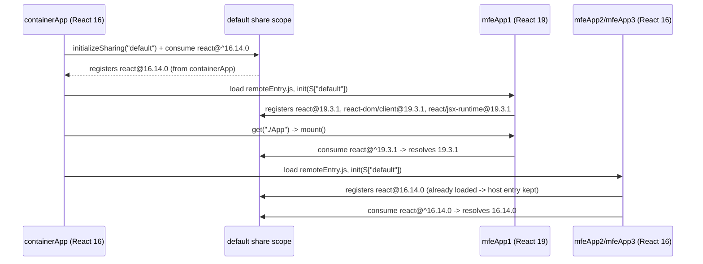

# Migration Option C — Multiple React Versions in the Default Share Scope

**Branch:** `migration/react19-multi-version-default-scope`
**Origin:** baseline commit `163dd263517373c80fbabc92eec3e11ba86b0aa1` on `main` (the same commit Option B started from; this branch contains no Option B commits)
**Scope:** MFE App 1 moves to React 19. Container, App 2 and App 3 stay on React 16.14.0.

This document is the Part 3 deliverable of [PRD section 6](./initial_prd.md). It describes
what was configured, how the coexistence actually works at runtime, the measurements and
test evidence behind those claims, the limitations found, and how to undo it.

---

## 1. Target matrix as built

| Application | React / React DOM | Share scope | `singleton` | `strictVersion` | Renderer |
|---|---|---|---|---|---|
| Container (`containerApp`) | 16.14.0 | default | false | true | `ReactDOM.render` |
| MFE App 1 (`mfeApp1`) | **19.3.1** | default | false | true | `createRoot` |
| MFE App 2 (`mfeApp2`) | 16.14.0 | default | false | true | `ReactDOM.render` |
| MFE App 3 (`mfeApp3`) | 16.14.0 | default | false | true | `ReactDOM.render` |

**Version change against the PRD:** the PRD pinned React `19.3.0` as the reference target and
asked for verification at implementation time. `npm view react dist-tags` reports
`latest: 19.3.1` (a stable, non-canary patch of the 19.3 line), so both `react` and `react-dom`
are pinned to **19.3.1** — matching versions, as required. No experimental/canary package is used.

## 2. Default share scope configuration

All four builds come from one factory, [`shared/webpack.base.js`](../shared/webpack.base.js),
and differ only by the React generation they declare:

```javascript
// React 16 builds (container, App 2, App 3)
shared: {
  react:       { singleton: false, requiredVersion: "^16.14.0", strictVersion: true, version: "16.14.0" },
  "react-dom": { singleton: false, requiredVersion: "^16.14.0", strictVersion: true, version: "16.14.0" },
  "react/":    { singleton: false, requiredVersion: "^16.14.0", strictVersion: true, version: "16.14.0" },
  "react-dom/":{ singleton: false, requiredVersion: "^16.14.0", strictVersion: true, version: "16.14.0" },
}

// React 19 build (App 1) — identical shape, ^19.3.1 / 19.3.1
```

Each app's `webpack.config.js` passes `reactVersion: REACT_16_VERSION` or
`REACT_19_VERSION`; anything else makes the factory throw.

Rules honoured (PRD 6.3):

- **No `shareScope` option anywhere** — not at plugin top level, not per dependency — so both
  providers and consumers use the scope webpack names `"default"`.
- **No custom `shareKey`** — lookup keys are the package names (`react`, `react-dom`) plus the
  trailing-slash subpath keys (`react/`, `react-dom/`).
- **`singleton: false`** — two versions may be registered under one key.
- **Subpath sharing configured for both package roots and subpath imports**, with the same
  constraints, so `react` and `react/jsx-runtime` (or `react-dom` and `react-dom/client`) can
  never land on different generations inside one application.
- **Local fallbacks retained** — no `fallback: false`, and each workspace still declares its own
  `react`/`react-dom` dependency, so every app builds and runs standalone.
- **`eager` not used** (PRD section 11).

The host's remote definitions stay plain strings — `mfeApp1@http://localhost:3001/remoteEntry.js`
— which is what keeps remote initialization on the default scope:

```javascript
remotes: {
  mfeApp1: "mfeApp1@http://localhost:3001/remoteEntry.js",
  mfeApp2: "mfeApp2@http://localhost:3002/remoteEntry.js",
  mfeApp3: "mfeApp3@http://localhost:3003/remoteEntry.js",
}
```

## 3. How two React generations coexist in one scope

### 3.1 What webpack actually does

From the webpack 5 sharing runtime (`ShareRuntimeModule`, `ConsumeSharedRuntimeModule`):

1. Every build owns a runtime map `__webpack_require__.S`, and `initializeSharing("default")`
   creates/uses `S["default"]`. When a host loads a remote it calls
   `container.init(S["default"])` — **the same object** is handed to the remote, which is why a
   single scope can hold registrations from all four builds.
2. Registration is per version: `S["default"][shareKey][version] = { get, from, eager }`.
   `from` records the `output.uniqueName` of the build that offered that version. With
   `singleton: false` nothing prevents `react` from having both `16.14.0` and `19.3.1` entries.
3. Consumption selects among the registered versions **that satisfy the consumer's
   `requiredVersion`**, preferring the highest match. `^16.14.0` can never select `19.3.1` and
   `^19.3.1` can never select `16.14.0`: the semver constraint — not the singleton flag — is what
   separates the generations.
4. `strictVersion: true` means an unsatisfied requirement **fails loudly** instead of quietly
   using another version. Combined with the fallback rules in 3.3, this is what makes silent
   cross-generation resolution impossible in this setup.
5. If two builds register the *same* version, webpack keeps the already-loaded entry; otherwise
   the winner is decided by `uniqueName > activeVersion.from`. Because the container consumes
   React in its own bootstrap before it ever loads a remote, its `16.14.0` entry is already loaded
   when App 2 and App 3 register theirs, so the container's provider stays in place (see the
   measurement in 4.2 and the caveat in 6.3).

### 3.2 Registration order



## 3.3 Fallback behaviour

`singleton: false` does not disable local fallbacks, and they were deliberately kept:

- The emitted builds show the fallback wired but not taken, e.g.
  `consume shared module (default) react@^19.3.1 (strict) (fallback: ./node_modules/react/index.js)`.
- Standalone pages (`http://localhost:3001/` … `:3003/`) prove an application can resolve its own
  copy when no provider exists — verified by the `every remote also boots standalone` integration
  test, which asserts exactly one React instance per standalone page.
- With `strictVersion: true`, an *unsatisfiable* requirement raises instead of silently using a
  wrong-generation fallback. That is the intended loud failure mode for this migration.

## 4. Shared dependency resolution — verification

PRD 6.4 forbids trusting `package.json` or the `shared` block as proof. Three independent channels
were used.

### 4.1 Runtime instance identity

[`shared/runtime-identity.js`](../shared/runtime-identity.js) records, on a page-level registry,
the identity of the **module object** each application resolved, keyed by a `WeakMap`. A version
string proves nothing under `singleton: false` — a silent local fallback prints `16.14.0` too — but
a second copy of React 16 is a *different object* and shows up as a second instance.

Every mount contract reports it (`getRuntimeInfo().identity`), each application registers itself
when it mounts, and the container registers itself at bootstrap. The Diagnostics page renders the
census; the tests read `window.__mfeRuntimeIdentity__` directly.

Measured result (production build, all four applications active):

| Instance | Version | Consumers |
|---|---|---|
| `react-1` | 16.14.0 | `containerApp`, `mfeApp2`, `mfeApp3` |
| `react-3` | 19.3.1 | `mfeApp1` |

Four applications, two React instances, one per generation, no third copy — i.e. the React 16
consumers really share one provider out of the default scope, and App 1 really runs its own React 19.

### 4.2 Network evidence

`npm run perf:measure` ([`scripts/measure-runtime.js`](../scripts/measure-runtime.js)) drives the
real page and reports what the browser fetched. Across a session visiting every application:
**21 JS requests, 21 unique assets, 0 assets fetched more than once, 0 runtime errors**
(full table in [performance-option-c-runtime.md](./performance-option-c-runtime.md)).

### 4.3 Configuration and artifact assertions

- [`tests/unit/shared/webpackShared.test.js`](../tests/unit/shared/webpackShared.test.js) asserts,
  for each of the four configs: only the four expected shared keys, `singleton: false`,
  `strictVersion: true`, generation-specific `requiredVersion`, no `shareScope`, no `shareKey`,
  no `eager`, fallbacks not disabled, string-form remotes, unique `output.uniqueName`.
- [`tests/integration/share-scope-initialization/`](../tests/integration/share-scope-initialization)
  fetches each shipped `remoteEntry.js` and asserts it mentions its own generation, never the
  other one, and contains no `react16`/`react19` scope names.

## 5. React 19 application changes (App 1 only)

| Item | Change | Reason |
|---|---|---|
| `react`, `react-dom` | 16.14.0 → **19.3.1** | the migration target |
| `react-redux` | 7.2.2 → **9.3.1** | peer `react: ^18 \|\| ^19` (v7 blocks React 19) |
| `redux` | 4.0.5 → **5.0.1** | peer required by react-redux 9 |
| `react-router-dom` | 5.2.0 → **5.3.4** (still v5) | 5.2.0 pulls `mini-create-react-context@0.4.1`, whose peer range stops at React 17 and whose fallback uses the legacy `childContextTypes`/`contextTypes` APIs React 19 removed; 5.3.x is the last v5 release and drops it. **No route code changed** — the v5 public API is identical, so no v6 rewrite and no container/router-version churn |
| JSX transform | `mfe-app-1/babel.config.js` with `runtime: "automatic"` | React 19 automatic runtime; `import React` removed from the app's JSX files (kept in `ContactForm.jsx`, which uses `React.Component`) |
| Rendering | `createRoot` / `root.unmount()` via `react-dom/client` | `ReactDOM.render` and `unmountComponentAtNode` are removed in React 19 |
| `act` | imported from `react` in tests | `react-dom/test-utils` was removed |
| Dev tooling (workspace-local) | Jest 30, jest-environment-jsdom 30, babel-jest 30, RTL 16, @testing-library/dom 10, user-event 14, jest-dom 6.9.1 | the React 16-era root stack cannot drive React 19 |
| `redux` API usage | unchanged (`createStore`, `combineReducers`) | redux 5 still exports them; no application logic rewrite |

The mount contract is unchanged for consumers: `shared/mount-contract.js` gained a second factory
(`createRootMountContract`) next to the React 16 one, both returning the same
`{ unmount, isMounted, getRuntimeInfo }` handle. **No container code changed to mount a React 19
remote, and no React Bridge was introduced.**

Class components (`ContactForm`) and `connect()` continue to work; no `propTypes`/`defaultProps`
were in use, so nothing had to be restructured.

### 5.1 One functional change, deliberately fixed

`mfe-app-1/src/App.jsx` passed a **function** as `className` to react-router-dom v5's `<NavLink>`
— that is the v6 API. v5 forwards it to the DOM, so React 19 (dev) reports
`Invalid value for prop className on <a> tag`, and in production the tabs were never styled.
App 1 now uses v5's documented `className` + `activeClassName` pair. The identical latent pattern
exists in `container-app/src/components/Navigation.jsx` and was **left as it is on this branch**
(see 6.4).

## 6. Known limitations and findings

### 6.1 The pinned `version` field is load-bearing

`version` in the shared config decides what a build *offers* to the scope. Without it, webpack
reads the version of whichever copy a module graph happens to resolve, and (see 6.2) an
unintended copy could be registered under a generation that does not match its code. Pinning it
makes each build's offer explicit; `tests/unit/shared/webpackShared.test.js` keeps
`version`, `requiredVersion` and the workspace's own dependency in agreement.

### 6.2 npm-workspaces hoisting can leak the other generation into a build (found and fixed)

The first Option C build leaked: App 1's graph contained
`provide shared module (default) react@19.3.1 = ../node_modules/react/index.js` — **the repo-root
React 16 file registered as a React 19 provider**.

Cause: `react-router-dom` and `use-sync-external-store` are hoisted to the root `node_modules`
(because the 16-generation apps and App 1 agree on their versions), and their internal
`require("react")` resolves from that root context, i.e. React 16.

Fix: `resolve.alias` pins `react` and `react-dom` for each compilation to the package root that
**this build's own dependency tree** resolves
([`reactAliasFor()`](../shared/webpack.base.js)). The requests stay as plain `react`/`react-dom`,
so Module Federation still recognises and shares them (webpack matches module requests
*unresolved*); only the local copy — and therefore the provider registration — is pinned.
Regression coverage: the `resolves react/react-dom to the generation this build declares` unit
test, plus `any root-context react/react-dom files? — none` in the build stats.

This hazard is specific to an npm-workspaces layout with two React generations; it is not caused
by Option C itself.

### 6.3 A same-version provider is still a single winner

When several builds offer the *same* version of a package, only one factory serves it, and the
choice is made by webpack's rule in 3.1(5) (loaded entry wins, otherwise highest
`output.uniqueName`). In this application the host consumes React before any remote is loaded, so
`containerApp` is provably the React 16 provider (see 4.1). If a deployment instead loads remotes
from a page where the host has not yet consumed React — e.g. a remote loaded by another remote —
the winning provider could become a different build, and that build must then be reachable at
runtime. Verification hook: the `consumers` list per instance in Diagnostics.

### 6.4 Pre-existing container defect left untouched

`container-app/src/components/Navigation.jsx` has the same function-`className` pattern described
in 5.1. In dev-mode it logs two React warnings (the same messages App 1 produced before its fix);
in production builds the tabs are simply unstyled. It exists identically on `main`, is invisible to
the E2E suites (they run production builds where React's dev warnings are stripped), and is not
part of the sharing strategy — so it was left alone to keep `main`, Option B and Option C visually
comparable. Fixing it is a one-line change (`className` + `activeClassName`) and is recommended for
`main` separately.

### 6.5 Two React generations means two runtimes on the page

During the migration the page ships both runtimes (see the performance documents): roughly
`119.2 KiB` of React-16-bearing chunks and `221.7 KiB` of React-19-bearing chunks are fetched in
total. This is inherent to a gradual migration, not a defect of the default-scope approach; both
branches (B and C) pay it.

### 6.6 Jest temporarily exists at two major versions

`test:unit` runs the root project (Jest 26 + RTL 11 for the React 16 workspaces) and
`mfe-app-1`'s own project (Jest 30 + RTL 16). See [testing-guide.md](./testing-guide.md). The split
disappears once every workspace is on React 19.

## 7. Test results

Executed on this branch after `npm ci` (clean install) — production builds, real Module Federation
runtime, headless Chromium for the browser suites:

| Suite | Command | Result |
|---|---|---|
| Lint | `npm run lint` | 0 problems |
| Unit — React 16 projects | `npm run test:unit:legacy` | **50 passed** (10 files, incl. new `shared/webpackShared`, `shared/runtimeIdentity`) |
| Unit — React 19 project | `npm run test:unit:app1` | **16 passed** (5 files) |
| Integration (real MF, 4 apps) | `npm run test:integration` | **19 passed** (6 files, incl. new `share-scope-initialization`, `initialization-order`) |
| E2E (full container) | `npm run test:e2e` | **19 passed** (6 files) |
| Regression matrix (PRD 7.3) | covered by the suites above | see 7.1 |
| Builds | `npm run build` | 4/4 compiled, 0 errors, 0 warnings |

Baseline comparison: Part 1 had 34 unit + 8 integration + 17 E2E = 59 tests. Option C keeps every
baseline test (none removed, none weakened) and adds 45.

Two baseline assertions were *changed rather than removed*, both because the branch genuinely
behaves differently: the `react-version-resolution` and `react-runtime` suites now expect the mixed
16/19 matrix (PRD 7.3 "Correct React Version: Mixed 16/19"), and `mfe-app-3`'s contract test asserts
the fuller `getRuntimeInfo()` shape (renderer, scope, identity) that Option C added.

### 7.1 Regression matrix (PRD 7.3)

| Behaviour | Main baseline | Option B | Option C (this branch) |
|---|---|---|---|
| Container loads | Pass | Pass | Pass (`federation-loading`) |
| App 1 loads | Pass | Pass | Pass (`mfe-regression`, `app1.spec`) |
| App 2 loads | Pass | Pass | Pass |
| App 3 loads | Pass | Pass | Pass |
| Redux interactions | Pass | Pass | Pass (`app1/2/3.spec`, `application-isolation`) |
| Navigation | Pass | Pass | Pass (`navigation.spec`) |
| Mount/unmount | Pass | Pass | Pass (`mount-unmount`, incl. 6-activation sequence) |
| No critical console errors | Pass | Pass | Pass (0 errors, 0 failed requests in all browser suites) |
| Correct React version | All 16 | Mixed 16/19 | Mixed 16/19 (verified by instance identity, 4.1) |

### 7.2 Loading-sequence coverage (PRD 6.6)

`tests/integration/initialization-order/initialization-order.spec.js` runs the sequences the PRD
names — App 1 before Apps 2/3, Apps 2/3 before App 1, repeated switching (six activations), and a
full page refresh — each time re-asserting the mixed matrix, "exactly two React instances" and the
per-application Redux behaviour. Concurrent initialization (all remotes at once) is covered by the
Diagnostics probe in `share-scope-initialization`.

## 8. Performance measurements

- Build-side: [performance-option-c.md](./performance-option-c.md) (regenerate with `npm run build:stats`).
- Browser-side: [performance-option-c-runtime.md](./performance-option-c-runtime.md) (regenerate with `npm run perf:measure`).
- Reference: [performance-baseline.md](./performance-baseline.md) (Part 1, untouched on this branch).

Against the Part 1 baseline, App 1's production JS grows from 203.7 KiB to 296.8 KiB (React 19 plus
react-redux 9), while the three React 16 builds move by less than 1 KiB each — the sharing
configuration itself costs the other applications nothing. The page as a whole fetches 21 JS
requests / 573.2 KiB uncompressed, with each generation downloaded exactly once.

### 8.1 Measured against Option B

PRD 6.7 asks for the same procedure as Option B: production builds, `serve` on localhost without
compression, headless Chromium driven by Playwright, Resource-Timing/request-log based. Option B's
figures below are read from its own generated documents on
`migration/react19-share-scopes` (`performance-option-b.md`, `performance-option-b-runtime.md`);
Option C's figures were measured independently on this branch, not copied.

| Metric | Part 1 baseline | Option B (named scopes) | Option C (this branch) |
| --- | ---: | ---: | ---: |
| containerApp total JS (raw) | 185.9 KiB | 188.0 KiB | 189.3 KiB |
| mfeApp1 total JS (raw) | 203.7 KiB | 303.5 KiB | 296.8 KiB |
| mfeApp2 / mfeApp3 total JS (raw) | 181.4 / 181.3 KiB | 181.8 / 181.7 KiB | 182.5 / 182.4 KiB |
| JS requests for a full tour | not measured | 21 | 21 |
| Total JS transferred | not measured | 570.4 KiB | 573.2 KiB |
| Initial (first screen) JS | not measured | 486.5 KiB | 488.5 KiB |
| Assets fetched more than once | not measured | 0 | 0 |
| Runtime console/page errors | 0 | 0 | 0 |
| Distinct React runtimes on the page | 1 | 2 (one per scope) | 2 (one per generation) |
| Distinct React DOM runtimes | 1 | 2 | 2 |

Reading: the two strategies are **within ~0.5 % of each other on the wire** (570.4 vs 573.2 KiB,
identical 21 requests, no duplicate downloads in either), and both download each React generation
exactly once. Option C's App 1 build is ~7 KiB smaller than Option B's; this measurement does not
attribute the difference to a specific cause (both builds carry the same React 19 dependency set and
both use react-router-dom 5.3.4), so it is reported as an observation only.

Mount/load timings are **not** comparable at this precision and are deliberately not tabulated: two
consecutive runs of `npm run perf:measure` on this branch reported 172 ms and 58 ms for the same
milestone (localhost, cold cache, single worker). The stable quantities in this comparison are byte
and request counts plus the instance census; re-read them with `npm run build:stats` and
`npm run perf:measure` rather than quoting this table on a different machine.

## 9. Running and testing this branch

```bash
npm ci
npm start            # four dev servers: 3000 container, 3001-3003 remotes
npm run preview      # same four applications, production builds
npm run build && npm run test:all
npm run perf:measure # regenerate the runtime measurement document
```

Open `http://localhost:3000`, then **Diagnostics** to see the per-application runtime table
(version, renderer, scope, shared instance id) and the page-wide instance census.

## 10. Reverting to the intended final architecture

When every application is on React 19 the multi-version configuration collapses back to the
baseline shape — one version, one default scope, `singleton: true` (PRD 10.1). Steps, all in
[`shared/webpack.base.js`](../shared/webpack.base.js) and the four `package.json` files:

1. Move `container-app`, `mfe-app-2` and `mfe-app-3` to `react`/`react-dom` 19.3.1 and upgrade their
   React-bound libraries the way App 1 was (react-redux 9 + redux 5, RTL 16/Jest 30).
2. Give every `webpack.config.js` `reactVersion: REACT_19_VERSION`, then delete the
   `REACT_16_VERSION` branch of `SHARED_BY_REACT_VERSION`.
3. Switch the descriptor back to `singleton: true` (Option C's `requiredVersion` becomes `"^19.3.1"`
   for all four builds, so one provider satisfies everyone):

   ```javascript
   shared: {
     react:       { singleton: true, requiredVersion: "^19.3.1", strictVersion: true },
     "react-dom": { singleton: true, requiredVersion: "^19.3.1", strictVersion: true },
     "react/":    { singleton: true, requiredVersion: "^19.3.1", strictVersion: true },
     "react-dom/":{ singleton: true, requiredVersion: "^19.3.1", strictVersion: true },
   }
   ```

4. Keep the `resolve.alias` pinning: with one React version it becomes redundant but harmless, and
   it is the guard that keeps hoisted packages honest if versions ever diverge again.
5. Collapse the two Jest projects into one (root Jest 30 + RTL 16), delete
   `tests/unit/jest.app1.config.js`, `tests/jest.setup.app1.js` and App 1's dev-dependency block,
   and drop the `.eslintrc.js` override for `mfe-app-1` (all workspaces then use the automatic JSX
   runtime — the root `babel.config.js` should switch from `runtime: "classic"` to `"automatic"`).
6. No application code changes are required: the mount contract's React 16 flavour
   (`createMountContract`) is what retires, and its callers switch to
   `createRootMountContract` — App 2/App 3 already import the factory, so it is a one-line change per
   app. The container needs no change at any point.
7. Update the expectations in [`tests/expectations.js`](../tests/expectations.js) — every browser
   assertion reads its versions from that file.

This branch does not implement that final phase (PRD 10.1 puts it outside the three-phase scope).

## 11. Option B vs Option C (PRD section 10 dimensions)

Values marked *measured* come from this branch's own runs; values marked *reported* are read from
Option B's documentation on `migration/react19-share-scopes` (its code was deliberately not
consulted or reused, per PRD 8.4). This is the comparison input for the developer's decision; it is
not a recommendation to merge either branch.

| Evaluation dimension | Option B (reported) | Option C (this branch) |
|---|---|---|
| Configuration complexity | Named scopes must agree in three places (`shared.*.shareScope`, plugin top-level `shareScope`, host `remotes[name].shareScope`); its own notes record a silent-failure trap when the top-level option is omitted | One descriptor per generation selected by `reactVersion`; nothing to keep in sync across files *(measured: config diff is one object + one alias)* |
| Application code changes | Only App 1 (deps, JSX runtime, `createRoot`) | Only App 1 (same set) + one `NavLink` API correction *(measured: `git diff --stat` touches no container orchestration)* |
| Dependency duplication | Two React generations shipped | Two React generations shipped; App 1 build 296.8 KiB vs B's 303.5 KiB *(measured)* |
| Runtime performance | 21 requests, 570.4 KiB total, 486.5 KiB initial | 21 requests, 573.2 KiB total, 488.5 KiB initial — within ~0.5 % *(measured)* |
| Bundle sizes | containerApp 188.0 / App 1 303.5 / App 2 181.8 / App 3 181.7 KiB | 189.3 / 296.8 / 182.5 / 182.4 KiB *(measured)* |
| Loading behaviour | Each remote initialised in its own scope | One scope; every generation downloaded exactly once, 0 duplicate fetches, 0 console errors *(measured)* |
| Version resolution reliability | Scope name guarantees separation *if* all three places agree; otherwise silent fallback | `requiredVersion` + `strictVersion` guarantee separation; mis-resolution fails loudly, and instance identity proves the outcome *(measured)* |
| Initialization-order sensitivity | Sensitivity is at scope-name wiring, not load order | Tested: React 19 first, React 16 first, six repeated activations, refresh, concurrent probe — all resolve the same two instances *(measured)*. Residual: a same-version provider is chosen by webpack's `uniqueName`/`loaded` rule (6.3) |
| Regression test results | PRD 7.3 matrix green (its own suites) | PRD 7.3 matrix green; baseline suite unchanged in count and strength; 104 tests total *(measured)* |
| Developer maintenance effort | Must keep scope names correct in every new app/host | Adding an app = declaring its `reactVersion`; the risk to teach is the hoisting/registration hazard (6.2) rather than scope plumbing |
| Ease of reverting to singleton | Delete scope names + top-level `shareScope`, restore `singleton: true` | Delete the 16 descriptor + restore `singleton: true` — step list in §10 |

Option C's decisive property: **nothing in the host or the other remotes has to know that a remote
changed React generation** — the change is entirely inside App 1's build plus one descriptor.

## 12. Deviations from the PRD (all documented per section 11)

1. **React 19.3.1 instead of 19.3.0** — the PRD's own instruction to verify and pin the current
   stable 19.x at implementation time (PRD 6.2).
2. **`version` pinned in each shared descriptor** — not in the PRD snippet; required to make the
   provider registration deterministic (6.1).
3. **`resolve.alias` for `react`/`react-dom`** — not in the PRD; required to stop hoisted packages
   leaking the other generation into a build (6.2). Sharing semantics are unchanged.
4. **App 1's `NavLink` className switched to the v5 `activeClassName` API** — needed because React 19
   reports the v6-style function as an invalid DOM prop (5.1).
5. **No 18.3 intermediate checkpoint kept as a commit** — PRD 5.4 (referenced by 6.5) suggests using
   React 18.3 as a compatibility checkpoint but requires the branch to end on React 19. App 1 went
   directly to 19.3.1; every React 18→19 item in the PRD's checklist was still reviewed (5.x table).
   The checkpoint would only have added a temporary dependency state to this branch's history.
